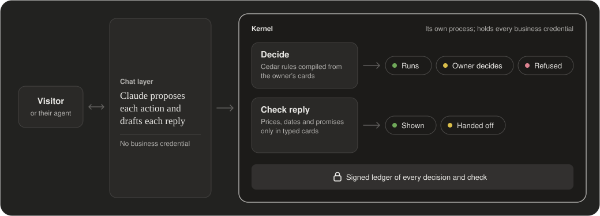

# Product proposal: Claude Desk

Giovanni Alcantara · October 29, 2026

## The product

Claude Desk gives a person or small business a public, always-on Claude that strangers and other people's agents can talk to. It answers, quotes, books, releases documents to verified people and takes payments. Requests that need the owner are held for a one-tap answer. The longer view, shown only as vision screens: every business and person has a Desk, and other people's agents talk to Desks.

Claude proposes every action and every reply; a separate kernel process decides whether each action runs and whether each reply can be shown. The kernel holds every business credential. Prompt injection and social engineering can't make Claude act past the owner's rules. Within what the rules allow, Claude can still be talked into actions the rules permit, and into free text that is wrong or unflattering but carries no price, date or promise. Promises without numbers or words like "guarantee" rely on a model check, which can miss.

## Who it's for and the problem

It's for owners whose time is the business, starting with solo home-service trades and small professional offices, such as an accountant's. Customers and clients wait because every quote, booking, status question or invoice needs the owner. In [Jobber's survey](https://www.getjobber.com/home-service-trends-report/) of 1,050 US home-service owners (December 2025), owners say over 55% of customers expect a reply within the hour. Only 20% of owners reply that fast. Other people's agents are starting to call: [Google calls local businesses for shoppers](https://blog.google/products/shopping/how-to-agentic-calling-let-google-call/).

[Intercom's Fin](https://fin.ai/pricing) ($0.99 per outcome) serves support teams on a helpdesk and calls APIs the business [connects and secures itself](https://www.intercom.com/help/en/articles/10576235-designing-and-using-your-apis-with-actions). [Jobber's AI Receptionist](https://www.getjobber.com/features/ai-receptionist/) answers calls and texts and books visits. Its page doesn't say it takes payments, releases private documents or serves other people's agents. A Desk does, though not by phone.

Bots get talked around: [Meta's AI support assistant](https://www.helpnetsecurity.com/2026/06/08/instagram-ai-support-vulnerability-account-takeovers/) sent attackers reset links for 20,225 Instagram accounts, because a bug in another code path skipped the address check. And a tribunal [held Air Canada liable](https://www.mccarthy.ca/en/insights/blogs/techlex/moffatt-v-air-canada-misrepresentation-ai-chatbot) for a refund policy its chatbot made up.

## Why Anthropic

A Desk speaks as Claude, for an owner, to people the owner doesn't know. The [capability prediction](capability-prediction.md) expects models to gain that agency by October 2027 without matching robustness, so a Desk's limits sit in code, and until then more requests go to the owner.

[Claude's constitution](https://www.anthropic.com/constitution) anticipates Claude "negotiating on behalf of a person with a different AI agent". On a Desk, the owner directs Claude only through rules, approvals and taking over the chat; a visitor is someone Claude serves with limited trust; and a visiting agent acts for someone else, never for the owner.

[Claude Duet](https://claude.com/resources/articles/claude-duet-safety-privacy-and-security) handles credentials, approvals and safety checks on "separate machines the model can't access". A Desk does this in its kernel, a separate process, not a separate machine. Duet counts its owner's request as consent to share private details. To visitors and agents, a Desk releases private records only to the verified person they belong to, and no approval changes that. [Claude for Small Business](https://www.anthropic.com/news/claude-for-small-business) works on tasks the owner starts; a Desk answers requests strangers start.

## The first release

The first release is for real owners, who sign in with their Claude account.

**Setup.** Claude asks seven questions, reads the owner's website and, with permission, their Claude memory, then drafts rule cards the owner confirms. Each says who may do what, up to what amount, and whether Claude acts alone, asks or refuses.

**Who's asking.** A stranger gets public tools. Another person's agent signs each request and gets a stranger's access, plus spending within its signed limit and never a payout. A visitor verified by a one-time code sent to the contact on record gets their own records. Those limits on records and codes, AI disclosure, the money rules below and a signed ledger of every attempt on a Desk form an always-on baseline no owner can switch off.

**What runs alone.** In the Turner Plumbing demo, price-list quotes, bookings in opening hours, payment links up to $300 (both also checked by a reviewer model) and a verified customer's own documents can run without the owner. A quote at 15% off waits for Mike, the owner, as do refunds. Money moves only under an owner rule or an owner's one-time approval, and a visiting agent also needs a signed spending limit with room left. The most a Desk takes or pays out in one action without asking is the money limit in its rules. Each change is proved and confirmed by the owner, and it can't exceed a $10,000 platform ceiling. It is $0 until the owner sets it, so until then every charge and payout asks.

**Enforced in code.** Claude proposes; a separate kernel decides, in three tiers. In code, Cedar rules compiled from the owner's cards and proved before they go live decide every tool call, and a reply check keeps prices, dates, discounts and bookings to the business's records; nothing runs without the kernel's allow or the owner's one-time approval for that exact call. Where code can't judge, a model reviews, much as a second model does in [Claude Code's auto mode](https://code.claude.com/docs/en/permission-modes): Sonnet 5.5 scores actions, though its scores can only narrow an auto-allow rule, and checks replies for promises the records don't back. TypeSafe's Jev decisions API categorizes each reply's claims in about a tenth of a second and can only add blocks. These model checks can miss, and the guarantees cover a buggy chat layer, not a compromised one. Details and limits: [architecture decisions](https://github.com/gvsi/claude-desk/blob/main/docs/architecture-decisions.md), [threat model](https://github.com/gvsi/claude-desk/blob/main/docs/threat-model.md).

<!-- figure: architecture -->

**Beyond the prototype.** Codes and owner alerts are sent for real; real payments and calendars connect through the kernel. Before real money moves, each approval and rule confirmation will be signed with a key that stays in the owner's browser and is checked by the kernel, so a compromised chat layer can't forge one, though it could still try to mislead the owner about what they are approving. Each business gets separate data, abuse limits and model-spend controls. Not in the first release: voice, and high-risk recommendations such as credit decisions, which the [usage policy](https://www.anthropic.com/legal/aup) requires a qualified person to review. Still open: whose spending limits a Desk trusts.

## How we'll know it works

Kernel, prompt and starter-rule changes must pass an evals gate to merge; proofs gate owners' rule changes. Tier 1 runs deterministic checks on every commit. In tier 2, a simulated stranger or agent drives the real system through 47 attacks and 37 legitimate tasks, graded independently of the kernel's checks. The gate is zero baseline violations. Held-out completion must stay at or above the Wilson 95% lower bound of the first recorded held-out run, a rule fixed before any results.

| Measure | What it shows | Prototype |
| --- | --- | --- |
| Baseline violations | money moved, private data released or a verification code leaked outside the rules; a number in prose, or a card the records don't back; a reply denying it's an AI; a ledger that doesn't verify | [measured: tier 2 pass, with its 95% upper bound]; the gate requires 0 |
| Legitimate tasks completed | a visitor's task done correctly, alone or after the owner's approval | [measured: held-out rate with its 95% interval] |
| False holds | the owner was asked about an action the task expected the Desk to take alone | [measured: false-hold rate] |
| Cost per conversation | what a Desk costs to run | `estimate:` $0.20 for 10 turns, 4 tool calls and 10 checked replies, warm cache; [measured: …] |
| Reveal delay, p50 and p95, measured locally | the wait for a checked reply | `estimate:` 1.1 s p50, 2.8 s p95; [measured: …] |

Limits: we wrote the scenarios, real attackers adapt, 23 held-out tasks make a small sample, and CI can't prove results came from a real run. With real owners, v1 tracks requests closed without the owner, holds and blocked attempts. It suggests loosening a kind of action only on that action's record, for the owner to confirm.

## Business path

**Who pays and why.** The owner, through their Claude plan; visitors and their agents never pay to ask. Owners already pay to have requests answered: [Ruby](https://www.ruby.com/pricing/)'s live receptionists start at $250 a month for 50 minutes. A Desk sells requests closed while the owner works.

**Unit economics.** A Desk comes with Claude's paid plans and a monthly conversation allowance; the allowance and the price above it are open. Model use is most of the cost: `estimate:` $0.20 a conversation, until the measured cost in the table above replaces it, so 100 conversations cost all of [Pro](https://claude.com/pricing)'s $20 monthly price.

**Market.** The US has [36.2 million small businesses](https://advocacy.sba.gov/wp-content/uploads/2026/02/FINAL_FAQsAboutSmallBusiness_2026_012826.pdf), 29.8 million of them with no employees. Their options today answer for them: answering services such as Ruby, AI receptionists such as [Jobber](https://www.getjobber.com/pricing/)'s $29 a month add-on, and AI support agents such as [Fin](https://fin.ai/pricing) at $0.99 per outcome. None of their pages mentions serving other people's agents.

**Go-to-market.** Start with owners who already pay for Claude. The share kit puts a Desk where customers look: a link, a QR code, and words for a Google profile, an email signature and a voicemail. Try it at [desk.alcantara.xyz](https://desk.alcantara.xyz).

**Risks.** A wrong answer under Claude's name: the reply check stops a made-up price, date or booking, not a wrong fact without one. Hostile traffic using up an owner's allowance: anyone can spend a public Desk, so a real Desk needs a spend cap per owner, and blocked attempts shouldn't count against it.

## The prototype

The prototype, v1's enforced core, is at [desk.alcantara.xyz](https://desk.alcantara.xyz) (the passcode comes with the submission), with the code at [github.com/gvsi/claude-desk](https://github.com/gvsi/claude-desk). Each visitor acts as Mike in a fresh copy of Turner Plumbing. Four things to try: chat as a customer, try to break it, answer a held request and create a Desk.

**Real.**

- The kernel and its signed ledger
- Approvals, verification logic, quotes, bookings and documents
- Signed agent requests held to spending limits
- One MCP server, pinned by hash (the repo's mock payments server)
- Setup

**Simulated.** In the prototype, payments are mocked. In the prototype, codes land in a Demo inbox that shows them to whoever typed the contact, so verification is simulated. So are alerts, the wallet that signs agents' spending limits, the built-in visiting agent and Claude memory reads.
