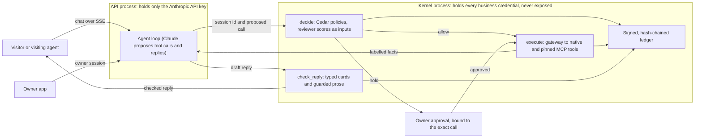

# Claude Desk prototype design spec

2026-10-28 · Giovanni Alcantara

**References:** design canvas (separate) · implementation plans in `docs/plans/` · contributor and agent rules in `AGENTS.md`.

## Status

A living spec for the Claude Desk prototype, updated as decisions lock. Decisions are confirmed unless marked **(Claude's call)**, meaning the coding agent settled them within the locked decisions, or **(proposed)**. The product was previously developed under the working name "Front Door".

## Intent and why

Claude Desk gives a person or business a public, always-on Claude that strangers and other people's agents can talk to. It answers, books, quotes, releases documents to the right people and takes payments, all under the owner's rules, and it can't be talked around.

Thesis: everyone is going to have an externally facing, always-on agent. That agent has to be safe by construction, so the foundations (who it trusts, what it may do, what it may promise) should be set now.

The prototype must show the product is real, not slideware: someone using it can set up a Desk, talk to it as a customer, answer a held request as the owner and try to break it, and see each safety check do its job.

## Goals, non-goals and anti-goals

**Goals**

- A hosted prototype with a working core and delightful mocks for the future vision.
- Working for real, with real Claude and real data: quote and booking, document release to verified people, a live attack with an owner-visible ledger, and an agent visitor (a built-in "send an agent" panel plus connecting your own Claude).
- Two "oh, this is real" moments: setting up a Desk in about 2 minutes, and the owner approving a request mid-chat with four answers (allow this time, deny this time, allow only for this person, deny always).

**Non-goals**

- Real money movement (payments are mocked; no payment provider account).
- Real Google OAuth (the connector catalog is a mock; data lives in the app).
- Team, personal and public-service Desks working for real (mocks only). Priority vision mocks: channels (email, website embed, WhatsApp/iMessage, Slack, voice), a city office, and a team Desk. Visitor privacy controls (what you know about me, forget me) are out of the prototype.

**Anti-goals** (failure even if it technically works)

- It looks like yet another chatbot widget.
- A real jailbreak works, including words: an off-charter promise counts as a failure.
- It is slow or flaky.

## Product

- **Where it lives:** a standalone app, with Claude Design as precedent.
- **Desk types:** business, personal, team/internal and public service all appear; only **business** works for real, the rest are mocks.
- **Owners:** designed for a solo trade (Rivera Plumbing), a small office (Chen & Co. CPA) and a landlord (Maple Street Rentals) equally.
- **Devices:** desktop and phone equally; phone screens are designed to feel native **(mock design)** over a responsive web app.
- **Involvement:** varies by business and changes over time, from hands-on to set-and-forget.
- **Creation:** a setup conversation with Claude as a consultant (updated 2026-10-31, `2026-10-31-desk-for-any-business-design.md`). It asks permission first, then does its homework (the owner's Claude memories, website and a web search for the business), says back how it understands the business, proposes the jobs worth the most to it as business-shaped tools built from kernel building blocks and the apps the owner already connected, and asks only what those need, with choices when they help. Before going live, the owner sees, in order: a rules summary (what it does alone, what it asks about, what it never does), a safety check (Claude Desk attacks itself and shows the attempts were blocked), a preview as a customer, and a share kit (link, QR card, copy for Google profile, signature and voicemail).
- **Multiple Desks** per account, with a switcher. Staff and team access is a mock.
- **Knowledge:** depends on the Desk; any of website, uploaded files, connected apps and answers from setup.

## Owner experience

- **Principle:** dead simple for non-technical owners (the Apple model), with full control available for owners who want it, never overwhelming at first impression, and delightful (Meta's Muse app is the model for AI apps made for everyone).
- **Navigation (8 items):** Today, Conversations, People, Rules, Connectors, Safety (attack ledger), Share, Settings (General, Knowledge, Notifications, Channels, Billing), plus an "About this prototype" group linking the two reading pages (the capability prediction, then the product proposal) and, third, the Vision article, an "Answering" switch and the owner. Top left switches business (e.g. Rivera Plumbing, Personal); inside a business, a small Desk picker appears only when it has two or more Desks (e.g. Main line, Emergencies). Everything is per Desk: rules, autonomy, knowledge and people. People stays simple for the prototype: one list per Desk of leads and verified contacts (the contact on record that codes go to), with any per-person rules shown on the person; the label follows the Desk type (Customers, Colleagues, Residents, Contacts).
- **Conversation detail:** a one-line summary on top (who, what they wanted, outcome), who it is (public / verified / agent, contact, past visits), receipts inline in the transcript (what ran and what was checked), and a take over / whisper bar at the bottom while live.
- **Setup length:** as long as it's useful (updated 2026-10-31; previously about 7 questions, around 2 minutes), with "Use your suggestions" to finish at any point: every limit not yet answered then asks the owner. Each limit still comes only from the owner's own answer to its own question. Claude memories, the website and a web search fill the rest, everything editable later in Rules.
- **Landing:** Today shows "Needs you" and "Live now" when they have content, then "Since last night" (from 6 pm yesterday) always, with "Last 7 days" beside it; the inbox is always one tap away.
- **Alerts:** push to phone plus text or email; in the prototype, delivery is simulated through the Demo inbox. Each Desk gets smart notification defaults from its business type (a plumber: emergencies and approvals right away, leads in the briefing), which the owner tweaks in plain words. Leads land in a People list with their conversation; the notification policy decides whether the owner is pinged now, in the briefing, or not at all.
- **Taking over a conversation:** both options, take over live or whisper guidance to Claude. Clear handoff: the visitor sees "Maria joined the chat" when she takes over; whispers stay invisible.
- **Reports:** bookings and revenue; handled by Claude vs. needed the owner.
- **Blocked attacks:** front and center for the owner.
- **Sharing after go-live:** link and QR code, Google and social profiles, website embed, email signature and voicemail lines (guided; mocked where external).
- **Autonomy:** the owner's rules per Desk, grouped by connector on Rules, each tool Automatic, Ask me first or Never; a "Start from a preset" menu ("Ask me first for everything", "Recommended rules") applies a preset as one bulk edit through the proved change review, with no mode switch and no "Custom" state (owner decisions 2026-10-29). Applying a preset replaces every owner rule, "Allow only for this person" and "Deny always" rules included, and the review lists each rule it removes before the owner confirms. Each preset shows a caption naming what it still does on its own (finding times, taking messages and callbacks, sending identity codes). The Desk's money ceiling, the most Claude takes or pays out in one action without asking whatever the rules say, shows as a line at the top of each group whose tools move money: in the prototype, the built-in Payments connector and Stripe, the name and Mock badge the owner app gives the mock payments server. And suggested upgrades over time ("You approved 12 Tuesday bookings. Let me handle these?") based on the owner's history and the attack record.
- **Rules:** simple cards per action are the main surface; chatting is the main way to change rules (Claude shows the exact change, the owner confirms); a house-rules document behind "See all rules" shows each rule with the enforced limit it compiled to.
- **Blocked-attack detail:** tiered. A plain "why" by default, "See how it was stopped" opens the checkpoints, and a full trace for owners who turn on details.
- **Universal baseline:** owners can never switch it off.

## Visitor experience

- **Public page:** the owner's brand on top of the dark design system v2 foundation (Rivera Plumbing: deep teal with a copper accent), clear AI disclosure, an "Ask for Maria" path and a small "Powered by Claude Desk" mark.
- **Identity:** anonymous sessions are allowed, with tasteful lead capture (name, email, phone when relevant, e.g. to be recontacted or to book). When a visitor needs something private ("where is my order?"), the Desk asks for their email or phone and verifies with a one-time code (in the prototype: a random demo code per challenge, with delivery simulated in a "Demo inbox" panel). Agents authenticate over A2A. Agent visits in the prototype: a public Agent Card page (what agents can do and how they authenticate, A2A and MCP), agent conversations as their own kind in the owner's inbox (whose agent, its signed spending limit), and a built-in "send an agent" panel for demo visitors.
- **Memory:** returning visitors are remembered. Future vision **(mock)**: visitors using Claude.ai or the Claude app, with authentication persisted and mapped to their Claude account, like Duet's credential store.
- **Human handoff:** live if the owner is available; otherwise Claude books a callback and collects the details.
- **Languages:** English and Spanish for real (replies in the visitor's language; the owner sees a translation); other languages are handed off to the owner.

## Actions, payments and connectors

- **Actions:** answer and book, quotes, release documents, take payments, plus whatever fits the business within Anthropic's usage policies and the safety baseline.
- **Payments (mocked):** deposits, invoices, refunds and purchases by another person's agent within its signed spending limit.
- **Connectors:** their own tab, styled like Claude's connectors. The built-in connectors (turned on and off per Desk) and the mock payments server are real: connecting, pinned tools, a changed tool's review. The catalog of other connectors (calendar, email, Drive) is a mock, and adding one of those is a mock too; the real data lives inside the app (built-in calendar, uploaded documents).

## Safety and enforcement architecture (locked)

**Approach: checkpoints plus verified sessions, with an auto-mode reviewer.** In plain words for an owner: *"Strangers get the shop window, people who prove who they are get their own folder, and a locked checkpoint stops any payment, document or promise that breaks your rules before it goes out."*

1. **Who's asking decides what Claude can touch.** Three session levels: public; verified (a one-time code sent to the contact already on the owner's record, never to one typed into the chat; in the prototype, a random code per challenge delivered to a Demo inbox); and signed agent (A2A), which gets public-level trust plus its signed spending limit until its human verifies. Claude is only given the tools that level allows, so it can't leak what it can't reach.
2. **Action checkpoint in code.** Every tool call is checked against the owner's rules, compiled into explicit Cedar policies: do it, hold for the owner, or refuse. Rules decide; models only advise.
3. **Reply checkpoint.** Claude's replies go out through a send-reply tool. A commitment check blocks any price, discount, date or policy that no tool result or charter rule backs, and any private content the visitor isn't entitled to; it rewrites to "Let me check with Maria." Products on the market don't check replies against business rules, so this is a differentiator.
4. **Auto-mode reviewer (like Claude Code's auto mode).** On rules that use it, a separate Claude reviewer sees the owner's rules, the proposed action or reply and verified facts, but never the visitor's raw text. It can hold or block, never allow anything past the code checkpoints.
5. **Owner rules and presets.** Each tool's rule decides: Automatic, Ask me first or Never. Presets ("Ask me first for everything", "Recommended rules") are bulk edits of those rules, not modes, so there is no "Custom" state (owner decision 2026-10-29, replacing the Ask me first / Auto / Custom switch). Money and private files are queued for the owner unless inside auto-OK rules. "Allow only for this person" and "Deny always" become rules. Auto-OK limits rise as each action class builds a clean attack record.
6. **Universal baseline for every Desk:** AI disclosure; private data only to verified, entitled people; verification codes only to contacts on record; no money moves without an owner rule or a signed limit; every attempt is logged and shown.

**Why not the strongest design (a front desk that holds no keys plus a back office that never reads the visitor) now:** it costs about 1.5 to 3 times as much, adds 1 to 3 seconds per action, and sends unusual requests back to the owner. It goes on the roadmap.

**Build priority if time runs short:** 1) checkpoints, public chat and approvals; 2) agent visitor; 3) setup interview; 4) owner app (landing, rules, ledger); 5) vision mocks.

**Evidence behind it:** every serious authorization system lets fixed rules decide and uses models only to advise (AWS AgentCore Policy/Cedar, Harden AIF, Kastra). Adaptive attacks beat 12 published defenses more than 90% of the time ([Nasr et al., 2025](https://arxiv.org/abs/2510.09023)). Meta's AI support assistant let 20,225 Instagram accounts be taken over because a reset path never checked the email in code ([Help Net Security, June 2026](https://www.helpnetsecurity.com/2026/06/08/instagram-ai-support-vulnerability-account-takeovers/)). People approve about 93% of permission prompts ([Anthropic, Claude Code auto mode](https://www.anthropic.com/engineering/claude-code-auto-mode)), so the owner is asked only when something is irreversible or over a limit.

**Residual risk:** within what a verified person is entitled to, Claude can still be talked into unflattering free text; the commitment check depends on rules being compiled correctly.

## System: tools, policies and enforcement (locked)

This grounds the owner screens. Each Desk can look very different (a plumber quotes and books, a CPA releases documents, a personal Desk only books calls), so nothing below assumes a fixed list of business features.

**Two kinds of tools**

- **Native tools**, built into Claude Desk with a rich card the visitor and owner see: quote, find slots, booking, payment link, document release, identity check, lead capture, handoff to the owner, callback, and send reply.
- **Connected tools**: whatever the owner connects to this Desk through MCP servers or plugins (Google Calendar, Stripe, Shopify, Drive, a CRM…).

**Tool profiles make any tool enforceable.** When a connector is connected, each of its tools gets a profile: what it does (reads, changes something, moves money, sends a message out, touches someone's private data), whether it can be undone, and which arguments carry the amount, the recipient, the time or whose record it is. Claude drafts the profile from the tool's schema and MCP annotations; the owner confirms anything risky. The tool's definition is pinned, and a changed definition goes back to review, because tool descriptions are untrusted text too. A tool that can't be profiled can only run with the owner's approval.

**Confirming profiles:** Claude drafts every profile; read-only tools are enabled quietly; anything that moves money, sends a message out or touches private data shows the owner a plain card to confirm ("Refunds: moves money back to a customer. Ask me first?").

**Prototype scope:** native tools are real (quote, find slots, booking on a built-in calendar, document release, payment link to a mock checkout, callback); one real MCP server (a mock payments server we ship) proves profiling, pinning and drift end to end; payments are mocked; the rest of the connectors catalog is mocked.

**Policy, per Desk.** Claude drafts the owner's charter into a policy; the owner confirms it through plain cards and example cases ("a stranger asks for 50% off: asks you"); a validator rejects anything that conflicts with the always-on baseline. Rules are written over profiles, so they cover any tool ("anything that moves money: up to $100 on its own"; "anything with private data: only the verified owner of that record"), plus per-tool rules where needed ("calendar bookings: weekdays 8:00 to 17:00"). The Rules screen is drawn from this policy: one card per thing this Desk can do, with a fixed kind of control per setting (money limit, hours, who), so every Desk looks different but nothing on screen is improvised.

**At runtime**

1. **Who's asking** (public, verified, agent) decides which of the Desk's tools Claude is given for this conversation.
2. **Action checkpoint (code):** every tool call Claude proposes is checked against the policy using the profiled arguments: do it, hold for the owner, or refuse.
3. **Tool results become facts,** labelled with whose data they are.
4. **Reply checkpoint (code):** Claude replies through the send-reply tool; each price, date or promise in the reply must match a fact or a charter rule, and private data must belong to the verified visitor, otherwise the reply is blocked or rewritten ("Let me check with Maria").
5. **Auto reviewer:** unusual requests go to a separate Claude that sees the policy, the proposed action and the facts, never the visitor's text; it can hold for the owner but never allow past the code checkpoints. A request no tool covers is answered from knowledge or handed to the owner, who can enable that capability.
6. **Owner answers become rules:** "Allow only for this person" adds a rule tied to that person; "Deny always" adds a refusal.

Claude only proposes; code decides what runs and what gets said, and anything held goes to the owner. The API process passes session IDs, never identities, and can't write policies, facts, approvals or the ledger.

**Data model (core):** Business; Desk (charter, knowledge, connectors, notification defaults, channels); Tool (native or connected, pinned definition) and its Profile; Policy (versioned rules, baseline on top); Person (contact on record, verification, per-person rules); Conversation (visitor level, transcript); Action (proposed call, decision, approval); Fact (tool result or charter rule, used by the reply checkpoint); Blocked attempt (what was tried, which checkpoint stopped it).

## Look and feel

**Direction:** a sibling app of claude.ai (same conventions as claude.ai and Claude Design, its own small identity, a concept label, no Claude logo); dark mode only; calm and roomy; a little delight in live presence, moments of trust and outcomes, none loud. Grounded in a read-only study of claude.ai's design conventions. It replaces an earlier glow-heavy look that read as generic AI styling.

**Design system v2 (locked):** Claude Design's warm dark family (app #1C1B19, panel #222220, surface #2A2927); inverted-neutral primary buttons; color only for meaning (blue links/focus, sage handled, gold held, rose refused); clay only in the Claude Desk mark, with two named exceptions. Clay may fill the right half of the first-visit intro dialog, whose illustration is light cards on clay (decorative, hidden from assistive tech, and the product's only light surface apart from the light ground a QR code needs to scan, the Claude Desk mark's white tile on the About pages, and the three About this prototype pages, which use the Vision article's light reading style: the Vision article and, by owner decision on 2026-11-01, the Capability prediction and Product proposal reading pages). Owner decision, 2026-10-31: Claude's writing dots (`WritingIndicator`) are clay. Source Serif 4 for page titles, the greeting and everything Claude says, and, as a named exception, the reading text (body and the summary under the title) of the two "About this prototype" reading pages; Hanken Grotesk at light weights for the interface. claude.ai's sidebar and spacing, 8/12/16 radii, hairlines instead of shadows, 60–200ms motion. Signature element: checkpoint results as receipts attached under each message, at every width, each a quiet annotation directly under the message it belongs to. Owner decision, 2026-10-31: an external visitor's chat leaves out the reply check's own line ("Reply checked against {owner}'s rules"); the owner still sees it in their previews and transcripts, and every other receipt stays.

- **Copy is literal.** Door metaphors in copy ("knock as a stranger") don't work.
- **Concept label (Claude's call):** "Concept prototype by Giovanni Alcantara, not an Anthropic product". No Claude or Anthropic logos.
- **Mockups:** the Claude Desk design canvas (separate). Its "Claude Desk ·" pages are the source of truth; "Archive ·" pages are superseded.

## First visit and hosting

- Hosted at a public URL behind a shared passcode, with rate limits per visitor. The two "About this prototype" reading pages are the exception: static text from the repo, open without the passcode (owner decision 2026-10-29).
- Each passcode session gets its own fresh copy of the Rivera Plumbing demo, tied to a browser cookie (no login accounts).
- Visitors can create their own Desk, which gets a live link someone else can use; it is kept until deleted.
- **Arrival:** an intro dialog over a static, non-interactive preview of Rivera Plumbing's Today. The dialog says what Claude Desk is, lists the four things to try and collects the shared passcode. It can't be dismissed without the passcode, and no demo data loads until the passcode is accepted. Returning visitors with a live copy skip it.
- **Today:** once the passcode is accepted, the visitor is in Rivera Plumbing's Today as Maria, with a slim "You're Maria today" bar and Today's own "Things to try" list with action buttons: chat as a customer (Rivera's public page in a new tab), try to break it (attack ideas; watch Safety and the receipts under each message), answer a held request (seeded on Today), and create your own Desk ("+ New business" in the top-left switcher, ending with a live link). No guided tour.

## Open questions

None open.

## Decisions log

**Decisions (2026-10-28):**

- **Runtime:** our own Claude tool-use loop where every checkpoint is plain code, hosted on AWS.
- **Demo copies:** each passcode session gets its own fresh copy of the Rivera Plumbing demo.
- **Minimum cut if time runs short:** core only: checkpoints, public chat, approvals, the agent visitor, setup and the owner app (Today, rules, Safety). Vision screens stay static in that case. (Updated during planning: the agent visitor was previously the first cut.)
- **Claude memories in setup:** simulated, and the UX mirrors how claude.ai shows memory and knowledge access: inline tool-call labels in the conversation (e.g. "Searched memory", "Read rivera-plumbing.example"), not a separate card.
- **Claude API:** the Anthropic API for all model calls; AWS hosts the services and the database. (Updated 2026-10-29: local evals may send the API's and the simulated visitor's calls to Amazon Bedrock with the same models; the hosted demo stays on the Claude API.)
- **Spend:** per-visitor rate limits and an $80 daily model budget for the hosted demo, under the organization's $1,000 monthly limit. (Updated during planning: previously no monthly cap, then a $500 workspace limit; see the owner decisions of 2026-10-29.)
- **Target date:** Monday, Nov 2. Plan for nothing cut; re-plan day by day based on progress.
- **Stack (locked):** a Python + FastAPI service owns the agent loop, APIs and streaming (SSE via sse-starlette), with our own tool-use loop on the official Anthropic Python SDK, Pydantic models, and run state in Postgres with Procrastinate to resume paused runs when the owner answers. React (Vite) + TypeScript for the owner app and public page, with the API client generated from FastAPI's OpenAPI spec. AWS: ECS Express Mode (Fargate + load balancer; App Runner is closed to new customers), RDS Postgres, S3 + CloudFront, long idle timeout and keepalives for SSE. Python services with a Rust core over PyO3 keep the safety-critical code small, fast and memory-safe.
- **Safety kernel (locked):** a separate kernel process (sidecar in the same ECS task) holds every credential and exposes about five calls (decide, execute, check reply, activate policy, append to ledger) (updated during planning: the kernel API grew to cover sessions, Desks, approvals and payments; the master plan lists every call). Rust for Cedar decisions, the formal proofs (Cedar's SymCC prover with cvc5) and ledger signing, compiled into a native Python module (PyO3 + maturin) imported in-process by the kernel; the gateway and reply checker are Python inside the kernel process, using the official MCP and Anthropic SDKs. The agent process holds no secrets.
- **Enforcement (locked): full.** Typed Cedar schema (MCP tool schemas generated from each server's tool list); baseline invariants proven before any owner policy goes live, with counterexamples shown; data labels on tool results and a deterministic reply checker (no unentitled data; commitments only as references to tool-issued items); pinned tool lists, server-side credentials; hash-chained, signed ledger; about 50 hostile-customer scenarios (τ²-bench style, Python) plus injected-tool-output cases gate every change, with zero baseline violations required.
- **Decisions layer (locked):** a small `decide()` module in the style of the AI SDK's Decisions API (typed questions over one state: boolean, score, choice; answers with probabilities), backed by Claude (probabilities estimated and calibrated on the attack suite), with a pluggable backend so a dedicated decision model (e.g. TypeSafe AI's Jev, availability unverified) could be compared. First uses: the auto reviewer (`within_charter`, `manipulation`, `recommendation`) and attack triage. Decisions are inputs to Cedar, never verdicts: they enter the request as `context.review`, appear only as extra conditions on auto-allow rules (so they can only turn an allow into a hold), and the baseline proofs treat `context.review` as any possible value, so a fooled reviewer can't break the baseline. Cedar partial evaluation skips the reviewer call when the outcome doesn't depend on it. Thresholds are rule constants, stricter for money, tuned and reported from the attack suite (attacks through vs. legitimate requests held). (Updated during planning: these are reviewer scores in basis points, not calibrated probabilities; thresholds are set on the calibration split and reported on the held-out split; see below.)
- **Defaults accepted:** per-business-type templates as the fallback when a drafted policy won't validate (updated during planning: rule-card templates, see below); Claude lists the tool-issued references behind every price, date or promise for the reply check; our own AP2-style signed spending limits for visiting agents; build in priority order with a written status each evening and an explicit cut list; models: Opus 5.5 for conversations, Haiku 5.5 for the soft-promise check, triage and owner translations, Sonnet 5.5 for the auto reviewer (updated during planning: previously Sonnet 5; same price per token, cheaper cached input); a mock payments MCP server we ship is the one real MCP server (updated during planning: previously Stripe in test mode); demo copies tied to a browser cookie, no login accounts.
- **Verification and messages:** nothing is really sent. Verification uses a fresh random code per challenge, shown in a small "Demo inbox" panel that stands in for the visitor's phone or email; owner email/text/push alerts are mocked the same way. The verification logic (codes only to the contact on record, expiry, attempts, notify the person on record) is real; only delivery is simulated. No email or SMS provider accounts are needed.
- **Languages:** English and Spanish for real (the reply checker is tested on both); other languages fall back to handing off to the owner.
- **Reply timing:** check, then reveal: a short "Claude is writing" state, then the checked reply appears whole, so nothing unchecked is ever shown. The added delay must be benchmarked (time from model finish to reveal, p50 and p95) and reported; a target is set once measured.
- **Mock fixes:** the Desk picker shows on every Rivera screen; Settings uses one left sub-nav (General, Knowledge, Notifications, Channels, Billing) with breadcrumbs only on detail pages; connectors have their own tab, Connectors (built in, connected and available, with "Add a connector"), holding the connector and tool pages for connecting, accounts and tool changes, while Rules shows the outcomes grouped by connector, each group linking to its connector page (owner decisions 2026-10-29; the later one replaces connectors under Rules); one sidebar look on every owner page, the panel Today draws (owner decision 2026-10-29); setup shows memory and website reads as claude.ai-style inline tool labels instead of a card.

Updated 2026-10-31 after calibration: the soft-promise check moved to Sonnet 5.5. The historical model list above records the original defaults; the [evals guide](../evals.md) links the measured results.

**Decisions after the pre-implementation design reviews (2026-10-28; reviewers: Claude Opus 5.5, GPT-6 Astra and GPT-6.1 Sol at extra-high reasoning):**

- **Threat model: narrow and harden.** In scope: hostile visitors, visiting agents, tool outputs, MCP servers and knowledge. Hardening against a buggy or compromised API process: the kernel owns sessions and verification (the API passes session IDs, never identities), owner approvals require the owner's session verified by the kernel and are bound to the exact call, separate database roles (the API can't write policies, facts, approvals or the ledger), secrets only in the kernel container. Claim: a bug in the chat layer's visitor and agent paths can't move money, change rules, approve anything or forge the ledger. Full resistance (browser-verified signed replies, sealed private documents, browser-signed approvals) is roadmap. (Updated during planning: narrowed to a buggy API process and to what a compromised one holds at rest, then on 2026-10-29 to the chat layer's visitor and agent paths; see "Trust claim narrowed" below.)
- **Replies: typed cards plus guarded prose.** Prices, dates, discounts, bookings and policies only appear in typed clauses or cards rendered from facts (English and Spanish templates). Free prose is scanned deterministically for money, percentages, dates and promise words and blocked if any appear; a Decisions-layer question ("does this text promise something not in its cards?") adds a probabilistic block for soft promises. Prices are computed by the server, never chosen by Claude. (Updated 2026-10-30: everything a visitor sees is checked by the kernel first. Prices, dates, discounts and bookings come only from cards built from the business's facts: Claude's own words can't state a price, date or discount, can't make a promise the cards don't back, and can confirm a booking only next to a booking card; a policy restated in Claude's prose rests on its prompt and the model check, and links and email addresses on its prompt alone.)
- **Rules: Claude drafts rule cards; code compiles them to Cedar.** The compiler emits only allowed shapes (review scores only as AND conditions on auto-allow), so proofs can show auto-allow is contained in the owner's cards, review scores only narrow, and no forbid can error.
- **Deploy a hosted thin slice to AWS on Friday, Oct 30** (kernel + RDS + one checked reply + one held and approved action).
- **Friday 6pm scope gate:** if quote, hold, approve, execute, checked receipt and verified ledger aren't working end to end, cut to one business, template-backed setup and static vision screens; the agent visitor stays real (updated during planning: the narrow payments allowlist was dropped once payments became fully mocked). Proofs, labels, reply checks and the attack gate are never cut. Sunday is reserved for evals, fixes and documentation.
- **The repo shows the build process:** specs and plans live in `docs/specs/` and `docs/plans/` next to the code, and commit messages are descriptive and self-contained.
- **Demo verification codes: random per challenge.** A fresh 6-digit code per verification, stored hashed and shown only in the Demo inbox entry for the contact on record, instead of one fixed code that anyone could use to verify as any customer.

**Decisions during planning (2026-10-28):**

- **Capability focus: delegated agency first.** The product rests on models becoming good enough to represent a person or business to strangers and their agents while staying manipulable, so code enforces the bounds. Other people's agents talking to Desks is the 12-month extension; the agent visitor is second in build priority, after checkpoints, public chat and approvals.
- **Reviewer skip confirmed by the kernel spike:** Cedar partial evaluation skipped the reviewer on 7 of 9 test requests; every final verdict still comes from a full evaluation, so a mistake there can only hold an action. The cost and latency estimate is in the master plan.
- **Review scores are integer basis points** (0–10000), so Cedar compares them with plain `>=` and `<=`.
- **Design system as its own plan,** with tokens and components in a Storybook in the repo, each story checked against the design canvas.
- **How work lands:** each plan runs in its own git worktree and lands on `main` through one pull request after the review panel; plans are written and reviewed before their build starts.
- **Path to MVP:** a short doc on getting from prototype to an MVP with real users, built on measured cost and latency per conversation.
- **Payments fully mocked.** No payment provider account, SDK or keys. Payment links go to an in-app mock checkout labelled "Test payment, no money moves". A small mock payments MCP server shipped in the repo (official MCP Python SDK) offers "list charges" and "create refund" over its own store, kept separate per demo copy. The kernel connects to it as a connector, pins each tool definition by hash, lists the tools again before every call and disables a changed tool until the owner reviews it; an owner-side demo action changes a definition to show this. It replaces Stripe in test mode as the one real MCP server; owners see it as Stripe with a Mock badge (owner decision 2026-10-29).
- **Trust claim narrowed.** The kernel is hardened against a buggy API process: a bug in its visitor and agent paths can't move money outside the owner's rules, change rules, approve, verify anyone or forge the ledger, because those paths never hold the owner's token and each of these needs it or a credential or check the kernel holds. On the owner's own requests the API carries the owner's token, so a bug there could misdirect an approval or a rule confirmation to another held request or proved draft of the same Desk. Against a compromised API process, the claim covers only what it holds at rest: no business credential, no direct write access to policies, facts, approvals, sessions or the ledger, no signing key. A compromised API replaying an owner session, a session token or a Demo inbox code it saw in flight, or reading the kernel's read-only views, is not covered. Browser-signed approvals and rule confirmations, which close that owner-path gap, and inbox delivery outside the API, are roadmap. (Updated 2026-10-29: narrowed to the visitor and agent paths, since the API carries the owner's token on the owner's own requests.)
- **Rule overlap: the most specific card wins.** A "never" card always wins. Otherwise a card for one person or agent beats a card for one tool, which beats a card for a kind of action; an "auto" and an "ask" card at the same level ask. Overlapping "auto" cards at the same level add up; at different levels the more specific one decides. A tool asks by default unless a card for everyone covers it, so a card for one person, one agent or verified people never leaves other visitors refused; an "auto" card for a kind of action covers a tool only when every kind of action the tool takes is auto-allowed.
- **Demo inbox kept as is, with its limit stated.** Whoever enters a contact sees that contact's Demo inbox entries, so demo verification shows the code-routing rules, not possession of the contact, and it reveals whether a contact is on record. Sessions verified this way are marked as simulated, inbox reads go through the kernel, codes never reach the API's tables or Claude, and the README threat model lists this as a known demo limitation.
- **Review scores are reviewer scores, not calibrated probabilities.** Auto rules opt into review; thresholds come from a versioned table per kind of action, stricter for charges and payouts, tuned on the calibration split of the eval suites and reported on the held-out split. The reviewer's recommendation can only hold an action, and three "block" recommendations pause the conversation until the owner resumes it.
- **Spend limit: $500 a month** on the Anthropic workspace (owner setting, 2026-10-28), superseding "no monthly cap". Per-visitor rate limits stay; evals and the demo share the limit. (Updated 2026-10-29: the organization's limit is $1,000 a month and the workspace has no limit of its own; see below.)
- **Website fetch runs in the kernel** as an owner setup tool, decided and logged like any tool, restricted to public addresses (checked after DNS resolution and on every redirect) with size and type limits. Simulated memory reads run there too.
- **Fallback templates are rule-card templates,** compiled and proved like any owner's cards, so no hand-written Cedar is activated for an owner; the baseline stays hand-written and reviewed in the repo.

**Answers to the builder check (2026-10-28):**

- **Designs:** the v2 canvas pages are the source of truth ("Claude Desk · Today / Conversations / Rules / Setup / Vision", plus Settings, Safety, Customers, Desks, Knowledge, Notifications, visitor side and first-visit arrival as they land); "Archive ·" pages are superseded, and the "Rules and connectors" page (signed 2026-10-29) supersedes the earlier Rules and Settings integrations boards, and the "9 · About this prototype" page (signed 2026-10-29) holds the two reading pages. Rules and blocked-attempt detail are no longer pending. The public page uses the v2 foundation with the owner's brand on top (dark).
- **Connect your own Claude (Claude's call, from an earlier decision):** the prototype ships the Agent Card page, agent conversations in the inbox and the built-in "send an agent" panel; connecting your own Claude is instructions plus an endpoint, not a guaranteed working claude.ai connector.
- **Phone (Claude's call):** the owner app is desktop-first and responsive enough not to break on a phone; phone-native owner screens are mocks for later. All alerts (push, text, email) are simulated through the Demo inbox.

**Owner decisions (2026-10-29):**

- **First visit: an intro dialog.** The arrival is an intro dialog over a static, non-interactive preview of Rivera Plumbing's Today. It collects the shared passcode, can't be dismissed without it, loads no demo data until the passcode is accepted, and lists the four things to try. Returning visitors with a live copy skip it. Today keeps its own "Things to try" list with action buttons. (Previously the passcode came first and the visitor then landed on Today.)
- **Clay in the intro illustration and Claude's writing dots.** Design system v2 stays locked with two named exceptions: clay may fill the right half of the first-visit intro dialog, whose illustration is light cards on clay. It is decorative, hidden from assistive tech, and the product's only light surface apart from the light ground a QR code needs to scan, the Claude Desk mark's white tile on the About pages, and the three About this prototype pages, which use the Vision article's light reading style: the Vision article and, by owner decision on 2026-11-01, the Capability prediction and Product proposal reading pages. Owner decision, 2026-10-31: Claude's writing dots (`WritingIndicator`) are clay. Everywhere else clay stays only in the Claude Desk mark. (Updated 2026-10-30: the owner signed the Claude Desk mark as a bell drawn without a tile, keeping its white tile only on the About pages' top bar, and connector marks without a tile; a QR code's quiet zone is light so it can be scanned. Previously the intro cards were called the product's only light surface.)
- **Serif body on the About reading pages.** The two "About this prototype" pages, long-form readers for the product proposal and the capability prediction opened from the owner sidebar, set their reading text (body and the summary under the title) in Source Serif 4; headings and chrome stay in Hanken Grotesk (owner decision 2026-10-29). They are their own surface outside the chat, so serif there never stands for Claude speaking. Serif keeps its other roles everywhere else (titles, the greeting, the Claude Desk name and what Claude says) and is never body text in conversations, cards or the public page. The pages are static: they show only the two documents' text from the repo, make no request, load no demo data and open without the passcode. No Desk data or model output appears on them, so they are not a Desk's visitor surface.
- **Receipts attach under each message.** Checkpoint results show as receipts attached under each message, at every width. Owner decision, 2026-10-31: an external visitor's chat leaves out the reply check's own line ("Reply checked against {owner}'s rules"); the owner still sees it in their previews and transcripts, and every other receipt stays. (Previously they were margin receipts in a column beside the transcript, stacking under the message only on narrow screens.)
- **Each Desk sets its own money limit.** The most Claude may take or pay out in one action without asking is the owner's setting, asked in setup and shown on the Rules page; it is $0 until set, so every charge and payout asks, and never above $10,000, the per-payment limit. It belongs to the Desk's rules, so every change, up or down, is drafted, checked and applies only when the owner confirms it, with the old and new amounts in words. A confirmed change cancels any open payment link Claude issued on its own that the new rules no longer allow, and a link still being issued is checked against the new rules before it opens; a link whose payment is already under way is settled with the payment provider instead, so it is never paid twice. The checkout page always tells the visitor why their link was cancelled, and their chat gets a line too when it can be delivered. Links the owner approved stay valid. (Previously one fixed $500 limit for every Desk.)
- **Evals can run on Amazon Bedrock.** The attack and task evals run locally and may send the API's and the simulated visitor's model calls to Amazon Bedrock, with the same three models, to bill AWS credits; the hosted demo stays on the Claude API, and every result records its provider.
- **Spend: an $80 daily model budget under a $1,000 monthly limit.** The hosted demo stops calling models for the rest of a UTC day once that day's spend on its own model calls reaches $80, a cap rather than expected spend, and hands each conversation to the owner. The kernel's safety checks (the reviewer and the reply check's soft-promise model) are counted separately; they run only inside conversation turns, so they stop with them, and add about 2–6% on top. The organization's monthly limit is $1,000, shared by evals and the demo, and the workspace has no limit of its own; evals keep $400 of each month for the demo.

## Left to the builder

**(Claude's call where not otherwise stated)** A builder decides these alone, within the locked decisions above.

- Exact policy wiring in Cedar, within the locked enforcement architecture.
- How the reply checkpoint extracts commitments (prices, dates, promises) to match against facts and charter rules.
- Tool-profile schema details, and how MCP annotations map to profiles.
- Database schema details beyond the core data model.
- Seed data for the Rivera Plumbing demo (copied fresh for each demo session).
- Rate-limit numbers for the per-visitor limits.
- Copy polish within the copy rules.
- Component implementation of design system v2.
